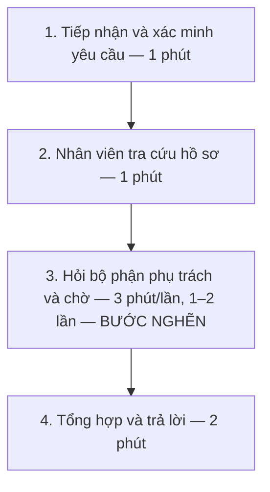
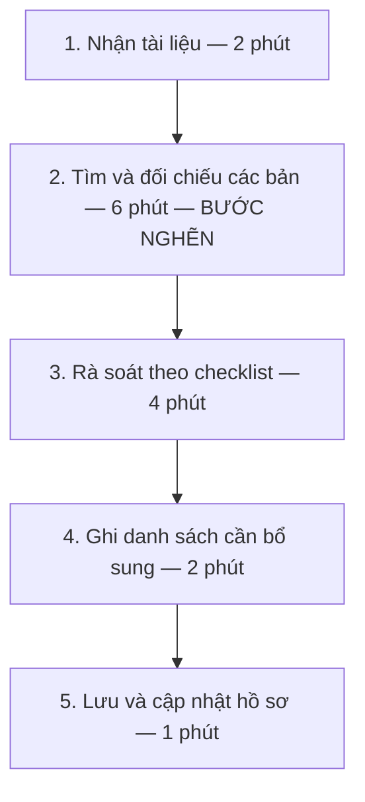
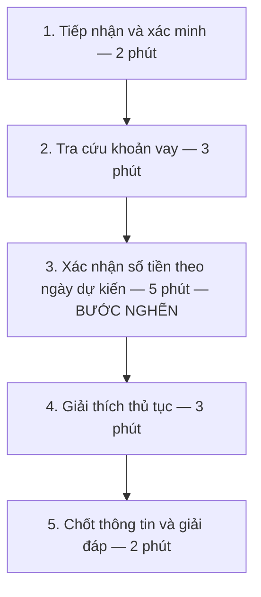

# Báo cáo cá nhân — MSSV_HoTen

## 1. Thông tin học viên

- Họ tên: Đoàn Văn Tú
- MSSV: 2A202603595
- Email trường (không bắt buộc, repo có thể để public): 26ai.tudv@vinuni.edu.vn
- Tên nhóm: NhomVIP208
- Link repo nhóm: https://github.com/congcoderht/K5-L3A-DAY02-NhomVIP208-DiscoveryProblemFraming

---

## 2. Scan problem (CP1)

**Lĩnh vực khảo sát:** Tiếp nhận, kiểm tra, theo dõi hồ sơ vay và hỗ trợ khách hàng trong quá trình vay.

**Phạm vi:** Nhân viên tín dụng và khách hàng vay vốn. Các vấn đề dưới đây là danh sách scan ban đầu, chưa phải bài toán cuối cùng của nhóm.

> **Ghi chú:** Các dấu hiệu dưới đây là giả định minh họa, chưa được khảo sát hoặc kiểm chứng. Thời gian được lấy bằng trung điểm của các khoảng giả định ban đầu, không phải trung bình đo từ dữ liệu thực tế. Số lần, số đợt và số khoản vay được giữ nguyên.

| # | Lăng kính | Job Story | Ai chịu ảnh hưởng? | Dấu hiệu giả định |
|---:|---|---|---|---|
| 1 | Tốn thời gian | Khi hồ sơ chờ duyệt, tôi muốn biết đang vướng ở bước nào để theo dõi và báo khách hàng. | Nhân viên tín dụng, khách hàng | Mỗi hồ sơ nhân viên phải hỏi thông tin khoản vay và khách hàng 1 đến 2 lần cho các câu hỏi khác nhau, mỗi lần mất 3 phút liên hệ và chờ phản hồi từ bộ phận phụ trách. Khách hàng phải giữ máy chờ tổng đài chuyển đến nhân viên hỗ trợ trực tiếp |
| 2 | Cần đọc, tổng hợp nhiều thông tin | Khi kiểm tra hồ sơ, tôi muốn biết thu nhập kê khai có khớp giấy tờ không để đánh giá chính xác. | Nhân viên kiểm tra, thẩm định hồ sơ | Nhân viên mất 15 phút/hồ sơ để đối chiếu thu nhập kê khai với sao kê và giấy tờ chứng minh thu nhập. |
| 3 | Cần đọc, tổng hợp nhiều thông tin | Khi nhận nhiều giấy tờ, tôi muốn biết bản nào mới nhất và còn thiếu gì để tránh nhầm lẫn. | Nhân viên tiếp nhận hồ sơ, khách hàng | Một hồ sơ được bổ sung giấy tờ 2–3 đợt do yêu cầu của ngân hàng cho vay hoặc khách hàng thiếu hồ sơ khi lần đầu tạo khoản vay; nhân viên mất 10 phút để tìm bản mới nhất và rà soát tài liệu còn thiếu. |
| 4 | Cần đọc, tổng hợp nhiều thông tin | Khi khách hàng đang vay nhiều nơi, tôi muốn đối chiếu tổng tiền trả nợ mỗi tháng với thu nhập để đánh giá khả năng trả thêm khoản vay mới. | Nhân viên tín dụng, thẩm định | Với khách hàng có 2–4 khoản vay tại nhiều tổ chức khác nhau, nhân viên mất 20 phút/hồ sơ để tổng hợp nghĩa vụ trả nợ từ các tài liệu có sẵn và đối chiếu với thu nhập. |
| 5 | Lặp lại | Khi tư vấn khoản vay, tôi muốn biết mức vay có thể đề xuất để tư vấn phù hợp với hồ sơ khách hàng. | Nhân viên tín dụng, khách hàng | Nhân viên mất 30 phút/trường hợp để đối chiếu điều kiện sản phẩm với thu nhập, nghĩa vụ nợ và thông tin hồ sơ trước khi đề xuất mức vay. |
| 6 | Pain từ người khác | Khi muốn trả hết khoản vay trước hạn, tôi muốn biết thủ tục và số tiền cần thanh toán để chuẩn bị đầy đủ. | Khách hàng muốn tất toán trước hạn | Khách hàng phải liên hệ 1–2 lần, trung bình 15phút cho mỗi cuộc trao đổi, để xác nhận thủ tục, dư nợ, tiền lãi và phí trả trước hạn nếu có. |

### Điều chỉnh sau khi dùng AI

Danh sách ban đầu được tự scan trước khi dùng AI. AI hỗ trợ kiểm tra cách diễn đạt, rút gọn Job Story, nhận diện các ý trùng nhau và xây dựng dấu hiệu giả định. Các thời gian giả định được đổi thành trung điểm: 5–10 → 7,5; 20–30 → 25; 10–15 → 12,5; 10–20 → 15; 15–30 → 22,5 phút.

| Ý ban đầu | Điều chỉnh | Lý do |
|---|---|---|
| Bổ sung hồ sơ vay online | Loại khỏi danh sách hiện tại | Theo nhận định ban đầu của người làm, chưa thấy khó khăn rõ trong phạm vi đang xét. Chưa xem đây là kết luận chung cho mọi sản phẩm vay online. |
| Biết số tiền trả mỗi kỳ | Loại khỏi danh sách hiện tại | Theo nhận định ban đầu của người làm, thông tin này đã được cung cấp; chưa có trường hợp cụ thể cho thấy người dùng vẫn gặp khó khăn. |
| Tra cứu lịch sử tín dụng và kiểm tra khách hàng vay nhiều nơi | Gộp thành vấn đề #4 | Cùng liên quan đến tổng hợp nghĩa vụ tín dụng để đánh giá khả năng trả nợ. |
| Khách hàng gian dối khi kê khai | Đổi thành kiểm tra chênh lệch thông tin ở #2 | Chưa có bằng chứng để kết luận gian dối; tập trung vào việc đối chiếu thu nhập kê khai với giấy tờ. |
| “Đáo hạn trước thời hạn” | Đổi thành “trả hết khoản vay trước hạn” ở #6 | Diễn đạt rõ nhu cầu tất toán trước hạn của khách hàng. |

**Điểm đã phản biện AI:** Hai gợi ý về bổ sung hồ sơ online và xem số tiền trả mỗi kỳ chưa phù hợp với nhận định thực tế của người làm nên đã loại khỏi danh sách. Không giữ một ý chỉ vì AI đề xuất.

## 3. Top 3 Problem Cards + quy trình nháp (CP2 - Individual)

### Bảng chọn Top 3

| Ưu tiên | Vấn đề từ CP1 | Vì sao chọn | Điều còn chưa chắc |
|---:|---|---|---|
| 1 | #3 — Tìm bản giấy tờ mới nhất và kiểm tra hồ sơ thiếu | Actor rõ; giới hạn ở bước kiểm tra hồ sơ; có thể minh họa bằng tài liệu giả lập; thời gian rà soát đo được. | Nhân viên chậm vì khó tìm bản mới nhất, checklist chưa rõ hay yêu cầu thay đổi? |
| 2 | #1 — Khách hàng phụ thuộc vào nhân viên khi tra cứu hồ sơ vay | Actor rõ; có thể thử trang tra cứu bằng hồ sơ giả lập và đo tỷ lệ tự tìm đúng thông tin. | Khách hàng cần thông tin nào? Nguồn dữ liệu đã sẵn có, cập nhật và được phép hiển thị chưa? |
| 3 | #6 — Xác nhận thủ tục và số tiền tất toán trước hạn | Actor là khách hàng; đầu vào và đầu ra rõ; đo được thời gian mỗi cuộc trao đổi và số lần liên hệ. | Khách hàng liên hệ lại vì thiếu hướng dẫn, vì số tiền thay đổi theo ngày hay vì yêu cầu nghiệp vụ? |

### Problem Card #1 — Khách hàng tự tra cứu thông tin hồ sơ vay

| Trường | Nội dung |
|---|---|
| **Job Story** | Khi cần biết thông tin hồ sơ vay, tôi muốn tự tìm được thông tin và việc cần làm tiếp theo để không phải gọi hỏi nhiều lần. |
| **Actor** | Khách hàng có hồ sơ vay; nhân viên tín dụng và tổng đài hỗ trợ khi khách hàng chưa tìm được câu trả lời. |
| **Thời điểm / bối cảnh** | Sau khi tạo hồ sơ, khách hàng cần biết tiến độ, giấy tờ cần bổ sung hoặc hướng dẫn cho bước tiếp theo. |
| **Quy trình hiện tại** | 1. Tiếp nhận và xác minh yêu cầu của khách hàng → 2. Nhân viên tra cứu hồ sơ → 3. Liên hệ bộ phận phụ trách nếu thiếu thông tin → 4. Tổng hợp và trả lời khách hàng. |
| **Bottleneck** | Bước 3: thông tin chưa sẵn có tại nơi tiếp nhận yêu cầu nên nhân viên phải liên hệ bộ phận phụ trách **1–2 lần/hồ sơ**, mỗi lần **3 phút**. Khách hàng phụ thuộc vào nhân viên để nhận thông tin. |
| **Impact** | Riêng bước liên hệ nội bộ mất **3–6 phút/hồ sơ**; quy trình hỗ trợ nháp mất **7–10 phút/hồ sơ**, chưa tính chờ tổng đài chuyển máy. Đây không phải số lần khách hàng gọi hoặc tổng thời gian khách hàng chờ. |
| **Success metric — mục tiêu đề xuất** | Với **10 nhiệm vụ tra cứu trên hồ sơ giả lập**, ít nhất **8/10 nhiệm vụ** được khách hàng hoàn thành đúng trong **2 phút/nhiệm vụ** tính từ lúc mở đường dẫn đến khi tìm được câu trả lời, gồm bước xác thực, không cần nhân viên hướng dẫn. Thông tin hiển thị phải khớp nguồn chuẩn và chỉ thuộc hồ sơ được phép xem. Tỷ lệ tự tra cứu hiện tại chưa có baseline; mục tiêu này cần thử nghiệm. |
| **Phương án không dùng AI / giải pháp đề xuất** | Gán một mã hồ sơ vay riêng khi tạo hồ sơ, cung cấp đường dẫn vào trang tra cứu. Khách hàng đăng nhập hoặc xác thực bằng kênh đã đăng ký, chọn/nhập mã để xem thông tin tổng hợp được phép công bố. |
| **Giả thuyết về AI** | Chưa cần AI cho phiên bản đầu. Nếu thử nghiệm cho thấy khách hàng vẫn khó tìm đúng mục hoặc hiểu hướng dẫn, mới cân nhắc hỗ trợ tìm kiếm hoặc giải thích từ nội dung đã duyệt. |
| **Cảm nhận nhanh** | **No AI / Rule**: trang tra cứu, xác thực, phân quyền và hiển thị dữ liệu theo quy tắc. |
| **Giới hạn** | Mã vay dùng để nhận diện hồ sơ, không thay thế xác thực. Khách hàng chỉ xem hồ sơ của mình; không hiển thị ghi chú thẩm định nội bộ hoặc dữ liệu người khác. Không tự sửa trạng thái, phê duyệt khoản vay hoặc thực hiện giao dịch. |

**Quy trình nháp hiện tại — 4 bước**

**Phác thảo giải pháp theo đề xuất của người làm**

1. Khi tạo hồ sơ, hệ thống gán **mã hồ sơ vay** và cung cấp đường dẫn trang tra cứu qua kênh đã đăng ký. Mã này có thể được liên kết với mã khoản vay sau phê duyệt; không mặc định hai mã là một.
2. Khách hàng mở trang, đăng nhập hoặc xác thực qua kênh đã đăng ký.
3. Hệ thống kiểm tra quyền xem hồ sơ; khách hàng chọn/nhập mã vay để truy cập trang tổng hợp.
4. Khách hàng tìm thông tin theo các mục dễ hiểu, xem việc cần làm tiếp theo.
5. Nếu chưa có câu trả lời hoặc thông tin cần xác minh thêm, khách hàng gửi yêu cầu hỗ trợ gắn với mã hồ sơ và câu hỏi cụ thể.

| Mục trên trang tra cứu | Nội dung dự kiến |
|---|---|
| Thông tin hồ sơ | Mã hồ sơ, loại khoản vay và thông tin nhận diện cần thiết đã được che bớt. |
| Tiến độ | Trạng thái hiện tại, thời điểm cập nhật và bước tiếp theo được phép thông báo. |
| Giấy tờ | Danh sách đã nhận, cần bổ sung và lý do bổ sung đã được nhân viên xác nhận. |
| Hướng dẫn | Việc khách hàng cần làm và câu hỏi thường gặp theo giai đoạn hồ sơ. |
| Hỗ trợ | Gửi câu hỏi kèm mã hồ sơ khi khách hàng chưa tìm được thông tin. |

### 3.3. Problem Card #2 — Tìm đúng giấy tờ và rà soát hồ sơ thiếu

| Trường | Nội dung |
|---|---|
| **Job Story** | Khi nhận nhiều giấy tờ, tôi muốn biết bản nào mới nhất và còn thiếu gì để tránh nhầm lẫn. |
| **Actor** | Nhân viên tiếp nhận và kiểm tra hồ sơ vay. |
| **Thời điểm / bối cảnh** | Khi nhận hồ sơ ban đầu hoặc tài liệu bổ sung. Một hồ sơ được bổ sung **2–3 đợt**, do yêu cầu của ngân hàng hoặc khách hàng thiếu giấy tờ khi tạo khoản vay. |
| **Quy trình hiện tại** | 1. Nhận tài liệu → 2. Tìm và đối chiếu các bản → 3. Kiểm tra theo checklist → 4. Ghi danh sách cần bổ sung → 5. Lưu và cập nhật hồ sơ. |
| **Bottleneck** | Trong kịch bản nháp, bước 2 — tìm và đối chiếu để xác định bản mới nhất — chiếm **6 phút**. Cùng bước 3 rà soát **4 phút**, tổng thời gian tìm bản mới nhất và kiểm tra thiếu là **10 phút**, đúng số liệu đầu vào. |
| **Impact** | Công tìm và rà soát mất **10 phút/lượt kiểm tra**; toàn bộ lượt kiểm tra nháp mất **15 phút**. Chưa có số liệu về tỷ lệ nhầm bản hoặc giấy tờ bị bỏ sót. |
| **Success metric — mục tiêu đề xuất** | Giảm thời gian tìm bản mới nhất và rà soát thiếu từ **10 xuống 5 phút/lượt**. Thử trên **10 bộ hồ sơ giả lập** có đáp án: xác định đúng toàn bộ bản cần dùng và không bỏ sót giấy tờ bắt buộc theo checklist đã chọn. |
| **Phương án không dùng AI** | Mỗi hồ sơ một thư mục; tên file thống nhất; ghi ngày nhận và trạng thái thay thế; dùng checklist theo một sản phẩm vay; yêu cầu bổ sung thành danh sách rõ ràng. |
| **Giả thuyết về AI** | Hỗ trợ phân loại nội dung giấy tờ và gợi ý đối chiếu checklist khi tên file không đủ rõ. Nhân viên xác nhận kết quả. |
| **Cảm nhận nhanh** | Thử **No AI / Rule** trước; cân nhắc **Workflow** nếu vẫn cần đọc hiểu nhiều tài liệu. |
| **Giới hạn** | Không tự xóa hoặc ghi đè bản cũ; không coi file tải lên sau cùng chắc chắn là bản hợp lệ; không kết luận hồ sơ đủ điều kiện được vay. |

**Quy trình nháp hiện tại — 5 bước**

### 3.4. Problem Card #3 — Hướng dẫn tất toán trước hạn

| Trường | Nội dung |
|---|---|
| **Job Story** | Khi muốn trả hết khoản vay trước hạn, tôi muốn biết thủ tục và số tiền cần thanh toán để chuẩn bị đầy đủ. |
| **Actor** | Khách hàng muốn tất toán trước hạn; nhân viên hỗ trợ là người tra cứu và giải thích. |
| **Thời điểm / bối cảnh** | Trước ngày khách hàng dự định thanh toán hết khoản vay. |
| **Quy trình hiện tại** | 1. Tiếp nhận và xác minh → 2. Tra cứu khoản vay → 3. Xác nhận các khoản tiền theo ngày dự kiến → 4. Giải thích thủ tục → 5. Chốt thông tin và giải đáp. |
| **Bottleneck** | Trong kịch bản nháp, bước 3 — xác nhận dư nợ, lãi và phí nếu có theo ngày dự kiến — mất **5 phút**, dài nhất trong cuộc trao đổi. Đây là giả thuyết cần kiểm chứng. |
| **Impact** | Khách hàng liên hệ **1–2 lần**, trung bình giả định **15 phút/cuộc**; tổng thời gian trao đổi **15–30 phút**. Chưa gồm thời gian chờ kết nối hoặc thực hiện thanh toán. |
| **Success metric — mục tiêu đề xuất** | Giảm thời gian trao đổi từ **15 xuống 10 phút/cuộc**, với cùng phạm vi câu hỏi. Thử **10 tình huống giả lập**; số tiền phải khớp bảng tính/nguồn chuẩn được cung cấp, hướng dẫn phải đủ giấy tờ và các bước theo kịch bản. Theo dõi số lần liên hệ, chưa đặt mục tiêu bắt buộc chỉ còn một lần. |
| **Phương án không dùng AI** | Checklist hướng dẫn; mẫu thông báo đầy đủ gốc, lãi, phí nếu có và ngày áp dụng; công cụ tính theo quy tắc đã xác nhận; gửi bản tóm tắt sau cuộc trao đổi. |
| **Giả thuyết về AI** | Giải thích hướng dẫn hoặc soạn câu trả lời từ thông tin đã xác nhận. Phần tính tiền thực hiện bằng hệ thống/quy tắc; nhân viên kiểm tra trước khi thông báo. |
| **Cảm nhận nhanh** | Ưu tiên **Rule** cho tính tiền; **Workflow** chỉ khi cần hỗ trợ giải thích nội dung. |
| **Giới hạn** | Không tự quyết định miễn phí, không tự thay đổi dư nợ hoặc thực hiện tất toán; phải chỉ rõ ngày áp dụng của số tiền được thông báo. |

**Quy trình nháp hiện tại — 5 bước**

### 3.5. AI phản biện dưới vai “PM hoài nghi” và chỉnh sửa trong bản nháp

| Card | Điểm bị phản biện | Điều chỉnh đã đưa vào bản nháp |
|---|---|---|
| #1 | Đang gộp thời gian khách hàng chờ tổng đài và thời gian nhân viên hỏi bộ phận khác. Có nguy cơ tính trùng hoặc chọn sai bước nghẽn. | Chỉ tính 3 phút/lượt hỏi bộ phận phụ trách; tách thời gian chờ tổng đài thành dữ liệu chưa có. |
| #1 | Gắn mã vay là giải pháp, chưa chứng minh khách hàng tự tìm được thông tin; chỉ biết mã không đủ để được xem dữ liệu. | Chuyển actor sang khách hàng, viết Job Story theo nhu cầu; tách giải pháp trang tra cứu, thêm xác thực và kiểm tra quyền xem. |
| #1 | Trang tra cứu không giúp ích nếu thông tin chưa cập nhật hoặc chỉ phục vụ nội bộ. | Bổ sung nguồn dữ liệu, thời điểm cập nhật, giới hạn thông tin công bố và cách chuyển sang nhân viên khi cần. |
| #1 | Thời gian hỏi nội bộ không phải thời gian khách hàng tự tra cứu, không thể so trực tiếp để tuyên bố tiết kiệm. | Giữ riêng số liệu cũ và đặt mục tiêu thử nghiệm 8/10 nhiệm vụ hoàn thành đúng trong 2 phút, chưa coi là kết quả đạt được. |
| #2 | Bản mới nhất chưa chắc là bản đúng; số đợt bổ sung không đồng nghĩa số lần lặp toàn bộ công việc. | Thêm bước đối chiếu bản, giữ lịch sử tài liệu; không nhân thời gian với số đợt. |
| #2 | “Nhanh hơn” chưa đủ nếu bỏ sót giấy tờ. | Thêm tiêu chí chất lượng: đúng bản cần dùng và không bỏ sót tài liệu bắt buộc trên bộ thử. |
| #3 | Liên hệ lần hai có thể do đổi ngày tất toán; không thể mặc định là hỗ trợ kém. | Đo thời gian theo từng cuộc, ghi lý do liên hệ lại và giữ ngày áp dụng của số tiền. |
| Cả ba | Số phút chưa được đo; AI không được biến giả định thành kết quả thực tế. | Ghi rõ nguồn giả định, tách thời gian đầu vào với thời gian chia nhỏ và mục tiêu đề xuất. |

### 3.6. Card muốn pitch nhất

**Chọn đề xuất:** Problem Card #2 — Tìm đúng giấy tờ và rà soát hồ sơ thiếu, tương ứng vấn đề **#3 của CP1**.

**Lý do:** Phạm vi hẹp, có thể vẽ rõ bước xử lý, thử bằng giấy tờ giả lập và đo thời gian lẫn lỗi. Không cần bắt đầu bằng việc tích hợp toàn bộ hệ thống tín dụng.

**Nội dung pitch ngắn:**

Nhân viên tiếp nhận phải xử lý giấy tờ được bổ sung qua 2–3 đợt. Trong kịch bản hiện tại, việc tìm bản mới nhất và rà soát tài liệu thiếu mất 10 phút mỗi lượt kiểm tra. Tôi muốn kiểm chứng bước nào thực sự làm nhân viên mất thời gian, sau đó so sánh cách chuẩn hóa thư mục và checklist với phương án hỗ trợ khác. Mục tiêu đề xuất là giảm xuống 5 phút mà vẫn xác định đúng bản và không bỏ sót giấy tờ bắt buộc.

**Câu hỏi muốn nhóm phản biện:**

> Nếu đã thống nhất cách đặt tên file, lưu phiên bản và dùng checklist theo sản phẩm vay, phần khó khăn nào vẫn còn mà cần giải pháp bổ sung?

## 4. Tôi đã tham gia phần nào (CP3 → CP7)

| Hoạt động | Tôi đã làm gì? | Kết quả / ảnh hưởng tới bài nhóm |
|---|---|---|
| Pitch Problem Card | | |
| Phản biện bài của bạn khác | Câu hỏi tôi đã đặt: | |
| Nhận phản biện | Câu hỏi tôi nhận được: | Tôi đã sửa gì: |
| Gom cluster / cây OST | | |
| Chọn candidate problem | | |
| Kiểm chứng / research | | |
| Quy trình nhóm | | |
| Problem Statement | | |
| Mức can thiệp AI | | |
| Quyết định | | |

---

## 5. Dùng AI

| Checkpoint | Tôi dùng AI để làm gì? | AI hữu ích ở đâu? | AI sai hoặc hời hợt ở đâu? | Tôi sửa gì bằng nhận định của mình? |
|---|---|---|---|---|
| CP1 Scan | | | | |
| CP2 Problem Card | | | | |
| CP4 Research | | | | |
| CP5 Quy trình | | | | |
| CP5–6 Problem Statement | | | | |
| CP6 Mức can thiệp / quyết định | | | | |

---

## 6. Reflection (CP7)

Trả lời bằng trải nghiệm thật của bạn, tối thiểu 200 từ cho các câu 6.1–6.6 (không tính 6.7, câu này được chấm riêng ở tiêu chí C5). **Không dùng AI để viết thay.**

**6.1. Tôi học được gì khi nghe top 3 problems của các bạn khác?**

**6.2. Nhóm có lúc nào bị "solution-first" (nghĩ giải pháp trước khi hiểu vấn đề) không? Lúc đó nhóm nhận ra và xử lý thế nào?**

**6.3. Tôi có đổi ý sau khi bị phản biện không? Kể một lần cụ thể.**

**6.4. Kết quả kiểm chứng (phỏng vấn/survey/research) có làm tôi bất ngờ không? Điều gì?**

**6.5. Điều khó nhất khi viết Problem Statement là gì?**

**6.6. Nếu làm lại, tôi sẽ đổi gì? Tôi sẽ phản biện nhóm mạnh hơn ở điểm nào?**

**6.7. Hiểu bài:** giải thích bằng 5–8 câu, không nhìn tài liệu, chuỗi *problem → quy trình → metric → boundary → mức can thiệp AI → quyết định* của bài nhóm mình.

---

## 7. Tài liệu tham khảo

-
